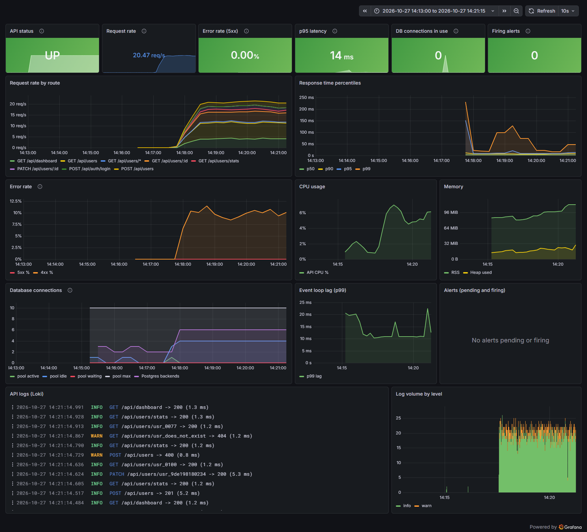

# Monitoring and logging

```
backend ── /metrics ──────────────▶ Prometheus ──▶ Alertmanager (routing, Slack/Teams/email)
postgres ── postgres-exporter ────▶     │
                                        ▼
all containers ── stdout ── Alloy ──▶ Loki ──▶ Grafana: "AdminFlow - Service Overview"
```

Start it with `docker compose --profile monitoring up -d`. Everything is provisioned from files in [`monitoring/`](../monitoring), so nothing needs clicking.



## What the API exposes

| Endpoint | Purpose |
|---|---|
| `GET /health` | Readiness: status, version, uptime, DB round-trip latency, memory, pool usage. 503 if the DB is down. |
| `GET /health/live` | Liveness: process is up. No dependencies. |
| `GET /metrics` | Prometheus text format (bearer-token protected when `METRICS_TOKEN` is set) |

### Metrics

| Metric | Type | Labels |
|---|---|---|
| `http_requests_total` | counter | `method`, `route` (pattern, e.g. `/api/users/:id`), `status_code` |
| `http_request_duration_seconds` | histogram (5 ms … 5 s) | same |
| `db_pool_connections` | gauge | `state` = total, active, idle, waiting |
| `db_pool_max_connections` | gauge | |
| `process_cpu_seconds_total`, `process_resident_memory_bytes`, `nodejs_heap_size_used_bytes`, `nodejs_eventloop_lag_p99_seconds`, … | default `prom-client` metrics | |
| `pg_up`, `pg_stat_database_numbackends`, … | postgres-exporter | |

## Dashboard panels

| Panel | Query idea | Requirement |
|---|---|---|
| API status, Request rate, Error rate (5xx), p95 latency, DB connections in use, Firing alerts | headline stats with thresholds | at-a-glance health |
| Request rate by route | `sum by (method, route)(rate(http_requests_total[…]))` | request rate |
| Response time percentiles | `histogram_quantile(0.5/0.9/0.95/0.99, …)` | latency percentiles |
| Error rate | 5xx % and 4xx % of API traffic | error rate |
| CPU usage, Memory | `process_cpu_seconds_total`, RSS + heap | CPU/memory |
| Database connections | pool active/idle/waiting vs max, plus Postgres backends | DB connections |
| Event loop lag | p99 lag | Node.js saturation |
| Alerts (pending and firing) | `ALERTS{…}` | alerting |
| API logs (Loki) and Log volume by level | `{service="backend"} \| json` | log aggregation |

Health checks and Prometheus scrapes are excluded from the traffic panels (`route=~"/api/.*"`), so idle periods read as zero.

## Alert rules

Defined in [`monitoring/prometheus/alerts.yml`](../monitoring/prometheus/alerts.yml) and routed by [`alertmanager.yml`](../monitoring/alertmanager/alertmanager.yml).

| Alert | Condition | Severity |
|---|---|---|
| ApiDown | scrape of the API fails for 1 m | critical |
| HighErrorRate | 5xx above 5 % of requests for 5 m | critical |
| HighLatencyP95 | p95 above 500 ms for 5 m | warning |
| LoginFailureSpike | more than 20 failed or throttled sign-ins/min for 2 m (brute force) | warning |
| HighMemoryUsage | RSS above 400 MB for 10 m | warning |
| EventLoopLag | p99 lag above 200 ms for 5 m | warning |
| PostgresDown | `pg_up == 0` for 1 m | critical |
| DbPoolExhausted | queries waiting for a connection for 2 m | warning |

Critical alerts repeat hourly, warnings every 4 hours. `ApiDown` suppresses the error-rate and latency alerts it would otherwise cause. To get notifications, uncomment the Slack receiver in `alertmanager.yml` (or add Teams/email) and restart Alertmanager.

**Tested:** with load running, `docker compose stop db` makes `/health` return 503 and API calls return 500, and `PostgresDown` fires after 1 minute. `docker compose start db` and the alert resolves (see `screenshots/grafana-alert-firing.png`).

## Logs

The API writes one JSON line per event to stdout: an access-log line per request with `requestId`, `method`, `route`, `status`, `durationMs` and `userId`, plus start-up, migration and error events with stack traces. `x-request-id` is accepted from nginx or generated, and it is returned in every response, so a user-reported error can be traced to its log line.

Useful LogQL in Grafana → Explore → Loki:

```logql
{service="backend"} | json | level="error"                     # all errors
{service="backend"} | json | status >= 500                      # failed requests
{service="backend"} | json | durationMs > 250                   # slow requests
{service="backend"} | json | requestId="<id from response>"     # trace one request
sum by (route) (count_over_time({service="backend"} | json | status >= 400 [5m]))
```

Docker's log rotation is capped (`10m` × 3 files per container) so local disks don't fill.

## Production monitoring (Render)

- **Built in:** Render shows CPU, memory, HTTP request and response-time graphs and live logs for each service. It restarts unhealthy instances based on the health checks.
- **Same dashboard in the cloud:** a free Grafana Cloud stack can scrape `https://adminflow-api.onrender.com/metrics` with the `METRICS_TOKEN` bearer token (Connections → *Metrics Endpoint*). Import `monitoring/grafana/dashboards/adminflow.json` and load `alerts.yml` as Grafana-managed alert rules.
- **Logs:** Render → Workspace settings → *Log Streams* forwards all service logs over syslog/TLS to Grafana Cloud Loki, Better Stack, Datadog or Papertrail. The logs are already JSON, so the same LogQL queries work.
- **Uptime:** an external probe (Grafana Synthetic Monitoring, UptimeRobot) on `/health` catches outages that in-cluster monitoring cannot see.
